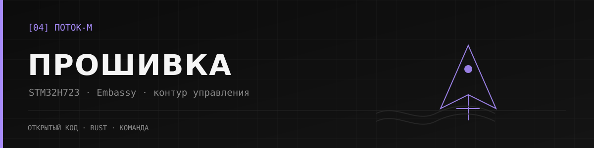

<!-- SPDX-License-Identifier: GPL-3.0-or-later -->



# Поток-М / прошивка

<span style="color:#a78bfa">STM32H723 · Embassy · no_std · Cortex-M7</span>

Контроллер, который решает. Машина, которая предлагает.

`STATUS  safety-core: implemented, host-tested  ·  board: todo!(schematic)  ·  flight-qualified: no`

---

## <span style="color:#a78bfa">01</span> / Роль

STM32H723 — главный. Он владеет фазой полёта, контуром стабилизации (PID),
командами приводам и интерлоками. Raspberry Pi — советник: крутит модель и
присылает поправки, Arduino-sized пакетом по UART. Прошивка решает, применять
поправку или нет.

Разделение зафиксировано в коде, а не в презентации:

- `phase.rs` — фаза живёт в `PhaseFsm` на контроллере; вReplyFrame поля фазы
  вообще нет, ИИ не может её выбрать или изменить.
- `control.rs` — один такт: запрос с фазой STM32, приём ответа, проверка seq,
  вето, watchdog. Никакого I/O и никакого аллокатора.
- `Command { pitch, yaw }` — единственный выход в мир через
  `Board::apply_command`. Безопасное состояние — `Command::ZERO`.

Контур стабилизации, сервоприводы и датчики — зона ответственности этого
контроллера по замыслу; в текущем скаффолде драйверы приводов и PID ещё не
написаны (`apply_command` — `TODO(schematic)`). Реализован слой решений и
интерлоков, который этих приводов дождётся.

---

## <span style="color:#a78bfa">02</span> / Граница безопасности

Семь правил. Нарушение любого — не «баг потом», а невыпуск прошивки.

`[01]` **ИИ запрещён на активном участке.** Пока работает двигатель (фаза
`BURN` или флаг `MOTOR_ARMED`), активной стабилизации нет — ни кода, ни сети.
`link.command()` возвращает `ZERO` при `!fsm.ai_allowed(flags)`, а `ai_allowed`
проверяет и фазу, и независимый бит `MOTOR_ARMED`. Спасение, разделение
ступеней и таймеры остаются на классике.

`[02]` **Фазу выставляет STM32.** Автомат (`phase.rs`) — только вперёд:
`BURN → COAST → APOGEE → DESCENT → LANDED`. Невозможное событие отклоняется,
а не откатывает фазу назад. Ответ ИИ фазы не содержит.

`[03]` **Вето кода.** Сеть не управляет рулями напрямую: она предлагает
ограниченную поправку, контроллер применяет или отклоняет её.
`Command::clamped()` режет `pitch`/`yaw` до `MAX_CORRECTION_RAW = 100` raw
(шкала 0.001 рад → предел модели 0.1 рад).

`[04]` **Три пропуска — блокировка.** Три подряд отклонённых кадра, таймаута
или кадра с несовпадающим seq (`MAX_CONSECUTIVE_MISSES = 3`) latch'ают ИИ.
`ai_healthy = 0` отключает ассистента немедленно, без трёх попыток. Валидный
кадр после latch обнуляет только `deadman`, но не сам latch — снимает его
только явный `LinkState::reset()` прошивкой. Счётчики `accepted / rejected /
disables` уходят в `defmt`.

`[05]` **Шум без magic — не пропуск.** `ReplyAssembler` выбрасывает байты до
`0x5250` без счёта ошибки; испорченный magic/CRC/версия/seq — считается.
Разделённый по DMA-чанкам magic собирается корректно.

`[06]` **Watchdog кормит только контур управления.** `watchdog::may_feed` —
`cycle_complete && !deadman_tripped`. pet вызывается в конце полного такта и
только если сработавший deadman не запретил кормление. Из UART-callback
watchdog не трогается. IWDG: таймаут `WATCHDOG_TIMEOUT_US = 100_000` мкс;
освобождённый — только сбросом.

`[07]` **Пины не выдумываем.** Номера выводов, альтернативные функции,
DMA-потоки и подключение серво назначаются только по схеме. В коде оставлены
явные `TODO(schematic)` и `TODO(bom)` — в `main.rs`, `memory.x` и
`firmware/Cargo.toml`.

---

## <span style="color:#a78bfa">03</span> / Архитектура

Слои идут сверху вниз; каждый зависит только от нижележащего. Хостовые тесты
подменяют `Board` моком и не знают о Embassy.

```
main.rs        Embassy, только target_os = "none"; реализует Board
     │
     ▼
board.rs       trait Board ─── mock.rs (MockBoard, только хост)
     │
     ▼
control.rs     step(), LinkState ─ phase.rs ─ deadman.rs ─ watchdog.rs
     │
     ▼
protocol.rs    SeqGate, ReplyAssembler + potok-protocol
uart.rs        trait'ы DoubleBufferRx / FrameTx, два статических слота DMA
```

Ключевые границы:

- **`no_std` везде.** `extern crate std` подключается только на хосте.
  Embassy-зависимости объявлены под `cfg(target_os = "none")`, поэтому
  `cargo test` собирает ту же логику с моками, а `cargo check --target …`
  поднимает реальный адаптер и IWDG.
- **Никакого аллокатора.** Статические буферы; кадры живут в стеке такта или в
  `StaticCell`. `panic = "abort"`, `lto = true`, `opt-level = "s"`.
- **Trait как шов.** `Board` — единственная граница железа: RX, TX, watchdog,
  время, флаги датчиков, событие фазы, применение команды. `MockBoard` на
  хосте скриптует байты RX, записывает отправленные кадры, считает pet и ведёт
  журнал применённых команд.
- **Один такт = 500 Гц.** `Ticker::every(2 ms)` в `main.rs`. За такт: событие
  фазы → `RequestFrame` с STM32-фазой и свежим seq → один кадр ответа → гейты →
  `apply_command` в любом исходе (отклонённый кадр и таймаут тоже выдают
  `ZERO`) → решение о pet.

Детальная карта модулей и инварианты — в [`docs/ARCHITECTURE.md`](docs/ARCHITECTURE.md).

---

## <span style="color:#a78bfa">04</span> / Протокол и соседние репозитории

Формат кадра не живёт здесь. `potok-protocol` подключён git-зависимостью,
запинен на ревизии `fdc485d14e8e10f500c2b81fce4ca9e5b1e64a55`.

| Репозиторий | Что делает | Граница с этой прошивкой |
|---|---|---|
| `potok-m-protocol` | `uart.yaml` → `generated/`; кодирование, магия, CRC-16/CCITT-FALSE, версия | Единственный источник wire-формата. Паковать и проверять CRC умеет он; `protocol.rs` только оборачивает и добавляет строгий seq + сборку из потока байт. Править формат — там. |
| `potok-m-ai` | Модель, обучение, инференс на Pi | Pi шлёт `ReplyFrame` (pitch, yaw, confidence, `ai_healthy`), STM32 — `RequestFrame` (фаза, датчики, `AI_READY`). |
| `potok-m` | Документация, sim, общие спецификации | Симулятор не покрывает железные тесты; они описаны в плане прошивки. |

Направление стрелок в `protocol/README.md` перепутано (метки `:16` и `:41`):
STM32 владеет датчиками и шлёт запросы (56 байт compat / 42 lowlat), Pi крутит
модель и шлёт ответы (14 / 16). Прошивка следует семантике полей, а не этим
стрелкам; исправление меток — в лейне владельца протокола.

Полный план — [`FIRMWARE_RUST_PLAN.md`](FIRMWARE_RUST_PLAN.md).

---

## <span style="color:#a78bfa">05</span> / Сборка, проверка, прошивка

```sh
rustup target add thumbv7em-none-eabihf
cargo test                        # хостовые тесты на моках, без железа
cargo fmt --all -- --check
cargo clippy --workspace --all-targets -- -D warnings
RUSTC=$(rustup which rustc --toolchain stable) cargo check --target thumbv7em-none-eabihf
RUSTC=$(rustup which rustc --toolchain stable) cargo build --release -p potok-m-firmware --target thumbv7em-none-eabihf
probe-rs run --chip STM32H723ZGTx \
  target/thumbv7em-none-eabihf/release/potok-m-firmware
```

`probe-rs` (раннер прописан в `.cargo/config.toml`) можно вызвать с
`--erase-all` для чистой прошивки. `memory.x` задаёт FLASH 1024K @ `0x08000000`
и RAM (DTCM) 128K @ `0x20000000` — точные значения для STM32H723ZG из
`stm32-metapac` v21.0.0 (`src/chips/stm32h723zg/metadata.rs`, семейство
STM32H723/733 по DS12939). **NOT ASSIGNED:** точный вариант корпуса/флеша по
BOM не подтверждён; `zg` (1 MB) — рабочее предположение, `ze` — тот же H723 с
512 KB. Вариант чипа, `memory.x` и такт time-driver'а (`TIM2`) должны быть
сверены с BOM **до** первого включения; название чипа в probe-rs проверить
через `probe-rs chip list`.

CI — три обязательных workflow на `ubuntu-latest`, все с toolchain
`dtolnay/rust-toolchain@stable`:

- [`ci.yml`](.github/workflows/ci.yml): `host` — `fmt`, `clippy -D warnings`,
  `cargo test --workspace`; `thumb` — `cargo check --target thumbv7em-none-eabihf`.
- [`sil.yml`](.github/workflows/sil.yml): `sil` — полный хостовый прогон, два
  фокусных ре-рана (wire-фолты и тайминг/watchdog) и `thumb no_std check`.
- [`renode.yml`](.github/workflows/renode.yml): `smoke` — хост-контракт
  `renode_smoke`, сборка отдельного `thumb`-ELF и прогон в Renode (эмулятор,
  не плата); границы и запуск — в [`docs/RENODE.md`](docs/RENODE.md).

Тот же SIL-прогон локально перед платой — четыре команды из
[`docs/SIL.md`](docs/SIL.md):

```sh
cargo test --workspace
cargo test --test safety --test watchguard_tests --test protocol_link_tests
cargo test --test perf_tests --test scheduler_tests --test watchdog_tests --test timing_budget_tests
RUSTC=$(rustup which rustc --toolchain stable) cargo check --target thumbv7em-none-eabihf
```

UART: 2 Мбит/с, 8N1, DMA в обе стороны, путь к Raspberry Pi; RX — два
статических слота с переключением, пока контроллер проверяет один, DMA набивает
другой.

---

## <span style="color:#a78bfa">06</span> / Тесты безопасности

**303 хостовых гейта в 30 интеграционных бинарниках** (`firmware/tests/`) —
результат `cargo test --workspace` на момент этого коммита. Все гоняются на
`MockBoard`, без платы, без Embassy и без аллокатора. Десять канонических
гейтов безопасности живут в [`firmware/tests/safety.rs`](firmware/tests/safety.rs)
(таблица ниже); остальные расширяют тот же шов на прочие модули:

| Группа | Тестов | Что покрывает |
|---|---:|---|
| Безопасность — `safety.rs` | 10 | Таблица ниже: CRC, seq, BURN и `MOTOR_ARMED`, три промаха, watchdog, assembler, FSM. |
| SIL — `sil_tests.rs` | 22 | Детерминированные скрипты 500 Гц через [`sil.rs`](firmware/src/sil.rs): трасса, интерлок в пути привода, отказы link'а. |
| Wire и логи — `protocol_link`, `watchguard`, `fault_inject`, `replay`, `telemetry_log` | 61 | Повторная подача кадра, фолт-инъекция, seq wrap, журнал и replay. |
| Фаза и управление — `phase_fsm`, `control_pid`, `attitude`, `interlocks` | 50 | Автомат, PID, фиксированная точка/Q15, независимый гейт. |
| Последователи и борт — `deployment`, `separation`, `sensor_voting`, `search_beacon`, `buzzer`, `self_test`, `calibration_table` | 80 | Разделение ступеней, голосование датчиков, маяк, self-test, калибровка. |
| Тайминг — `perf`, `scheduler`, `watchdog`, `timing_budget` | 37 | Бюджет цикла 24 000 тактов, сетка 500 Гц, край срабатывания watchdog. |
| Профили и аэроданные — `profile_tests`, `shield_sample_tests` | 24 | Типовые рантайм-профили; питот/статик, Mach, счётчики UNAVAILABLE и сэмпл в `evaluate_shield`. |
| Полётный путь — `production_safety`, `flight_path_tests` | 16 | Настоящий `step()` с интерлоком и watchguard; каждый чистый модуль вызван, отказ посчитан с причиной. |
| Эмулятор — `renode_smoke` | 3 | Хост-контракт Renode: no-panic board и маркерный протокол. |

### SIL

SIL (software-in-the-loop) — отдельный хостовый прогон:
[`firmware/src/sil.rs`](firmware/src/sil.rs) — движок,
[`firmware/tests/sil_tests.rs`](firmware/tests/sil_tests.rs) — 12 гейтов.
Скрипт из `Tick`'ов гонит настоящие `step()`, `PhaseFsm`, `LinkState` и
`Interlocks` через `MockBoard` в синтетическом времени (тик *n* = *n* × 2 мс).
Интерлок стоит внутри пути привода: команда контроллера не доходит до борта,
пока не пройдёт независимый гейт. Трасса фиксированной ёмкости, переполнение —
`panic`, а не тихая потеря записи; одинаковый скрипт даёт одинаковую трассу.
Прогон запускается workflow'ом [`sil.yml`](.github/workflows/sil.yml),
границы описаны в [`docs/SIL.md`](docs/SIL.md).

SIL — фильтр регрессий, **не** лётная квалификация. Он ничего не доказывает
про пины, электрические сигналы, реальное время и плату. Зелёный `sil` необходим
перед работой с платой, но недостаточен, чтобы назвать прошивку лётной.

### Десять канонических гейтов безопасности

| # | Тест | Что ловит |
|---|---|---|
| 01 | `frame_encode_decode_roundtrip` | Кодек `potok-protocol`: запрос и ответ переживают encode→decode; magic `0x5250` на месте. |
| 02 | `crc_rejection_is_a_miss_and_produces_zero_command` | Испорченный CRC — это `FrameRejected`, `misses = 1`, `BadCrc` и `Command::ZERO` в журнале. |
| 03 | `seq_wrap_accepts_zero_after_max_and_rejects_stale` | `SeqGate` по модулю `u16`: после `MAX` принимается `0`, устаревший `seq` отвергается (`BadSeq`), команда нулевая. |
| 04 | `ai_ignored_on_burn_and_while_motor_armed` | В `BURN` валидный ответ даёт `ZERO`; после `Burnout` поправка проходит; поднятый `MOTOR_ARMED` снова обнуляет её вне `BURN`. |
| 05 | `three_misses_latch_ai_off_until_explicit_reset` | Три промаха latch'ают (`disables = 1`); валидный кадр latch не снимает; снимает только `reset()`. |
| 06 | `unhealthy_ai_disables_immediately` | `ai_healthy = 0` отключает ИИ сразу, без «трёх попыток», с нулевой командой. |
| 07 | `watchdog_and_deadman_state_machine` | Таблица `may_feed`; deadman срабатывает на третьем пропуске, свежий кадр его снимает; pet только после полного цикла и до срабатывания deadman. |
| 08 | `assembler_drops_noise_and_split_magic` | Шум до magic не считается ошибкой; разорванный magic собирается в кадр. |
| 09 | `double_buffer_receive_swaps_slots` | Два чанка приходят в разные слоты, `swaps = 2`. |
| 10 | `phase_fsm_is_forward_only` | Невозможный переход из `BURN` в `APOGEE` отвергается; цепочка до `LANDED` проходит; возврат из `LANDED` — ошибка. |

---

## <span style="color:#a78bfa">07</span> / Ограничения

Прошивка **не лётная** и **не введена в эксплуатацию**.

- **Нет bring-up на плате.** `hw::build_board()` намеренно `todo!()`:
  не назначены USART, TX/RX-пины, альтернативные функции, два DMA-потока и
  схема ping-pong прерываний. `Rx::take` и `Tx::send` — заглушки с
  `TODO(schematic)`.
- **Пины, DMA и проводка серво неизвестны.** `sensor_flags`, `motor_armed`,
  `poll_phase_event`, `apply_command` возвращают безопасные заглушки:
  FSM остаётся в `BURN`, активной стабилизации нет. Ни одного выдуманного
  номера вывода.
- **Variant чипа и линкер — по BOM.** `stm32h723zg`, `time-driver-tim2`,
  FLASH/RAM в `memory.x` — рабочие отправные точки (NOT ASSIGNED), требующие
  подтверждения по BOM до первого включения.
- **Железные тесты из плана не прогонялись:** логический анализатор на
  2 Мбит/с (длина кадров и время в бюджете 0.25 мс), час back-to-back без потерь,
  fault injection по магии/CRC/версии/seq, BURN-гейт с подключёнными серво,
  отключение UART и убийство Pi с проверкой watchdog reset, cold flash,
  brownout, запас RAM/flash. Симулятор их не заменяет.

Граница между хостовыми гейтами и платой — в [`docs/SIL.md`](docs/SIL.md);
процедура и пустые ячейки bench-записей — в
[`docs/HIL_CHECKLIST.md`](docs/HIL_CHECKLIST.md). Ни один из этих документов не
является отчётом о прогоне на плате.

---

<span style="color:#a78bfa">LICENSE</span> `GPL-3.0-or-later`
